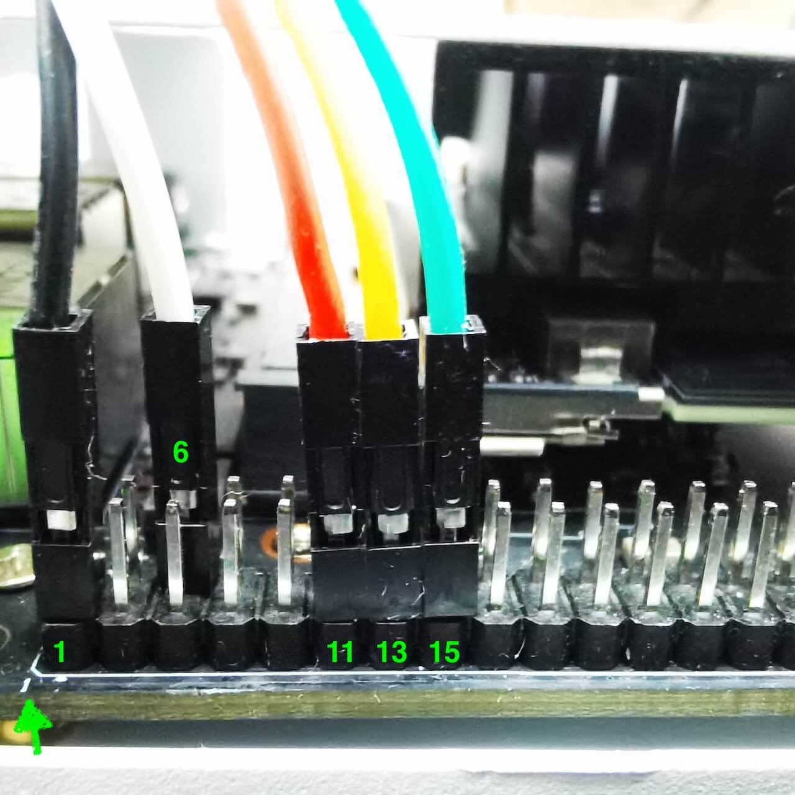
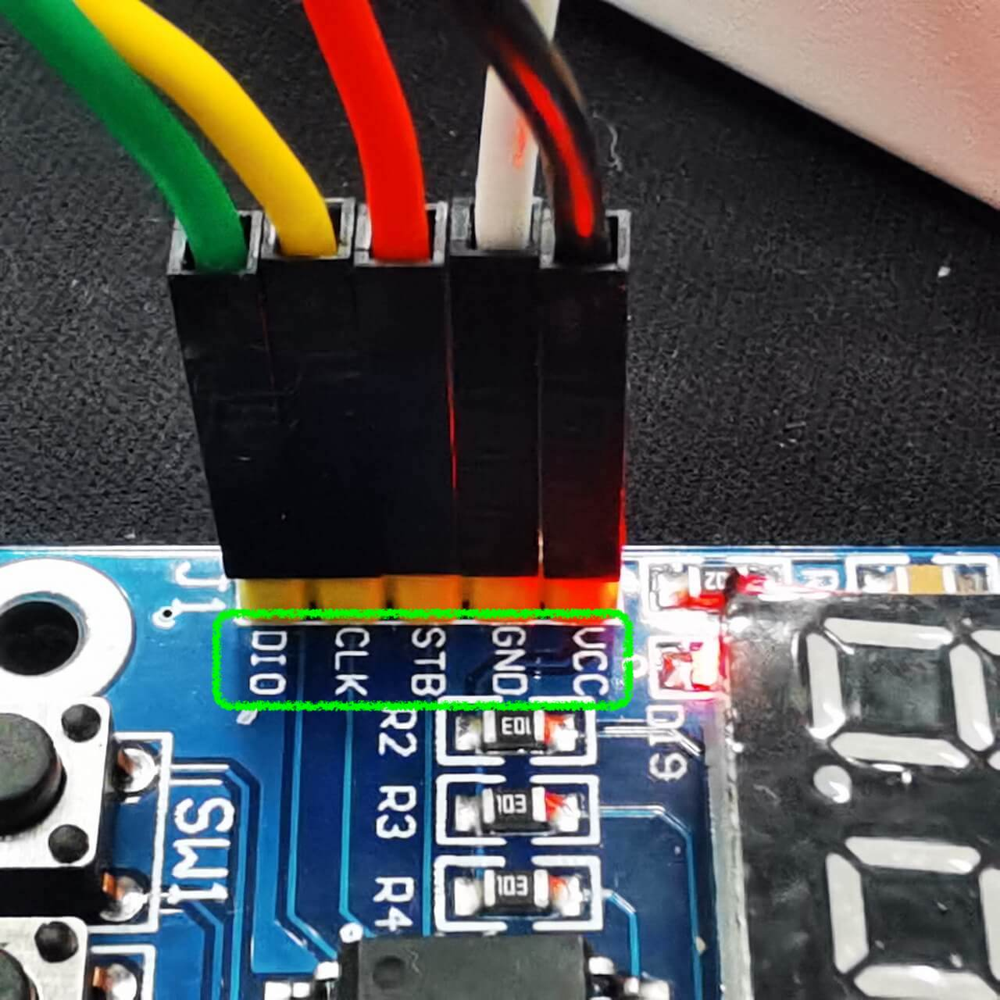

# NLP模拟控制-261215
{: .no_toc }

`更新-261116` \| `发布-261116`

<details markdown="block">
  <summary>✳️ 目录</summary>
- TOC
{:toc}
</details>

---

## 实验简介
<br>
通过 NLP（自然语言处理），模拟控制现实世界中的一些场景。比如模拟电梯楼层指示面板：数码管从1逐层跳到8，每跳一层对应位置LED点亮一次，到达后8个LED全亮数码管显示8并闪烁两次。

### 任务
<br>
请完成以下任务：

1、用 NLP 模拟控制现实场景，至少 5 种（不包括本文档中列出的 20 种）;<br>
2、体验本文档中列出的 20 种模拟控制现实场景，至少 5 种；<br>
3、（可选）体验用 agent（智能体）模拟控制现实场景。

### 主要硬件
<!-- <br> -->
- 开发板：NVIDIA Jetson Orin NX 16GB（Ubuntu / JetPack 5.1.3）
- TM1638 智控模块

[🔝](#top)

---

## 相关信息

### 操作规范
<!-- <br> -->
- 🚫 水杯、饮料瓶**不得放桌上**（放地上或包里）
- 🚫 电源线、网线**从桌子中间空洞穿**，不绕四周
- 🚫 书包等**远离开发板**（放地上）
- ✅ 关机后再断电

### 账号信息
<br>
开发板账号信息如下：

- 账号：cg
- 密码：cgremote

实验室 WiFi：（如果需要用到）

- 热点：b102_0712_5G
- 密码：b102b102gb5

### 快捷操作
<!-- <br> -->
- 按 `tab` 键可补齐文字，加快输入。假定当前目录下有 3 个子目录（face_mesh，gesture_recognizer，haar_detection），输入 `cd ges` 后按 `tab`键，则补齐为 `cd gesture_recognizer/`。
- 按 `↑↓箭头` 键，可以找到输入过的命令。不必每次都重复敲命令。
- 终端App中：（复制） `Ctrl` + `Shift` + `C`；（粘贴）`Ctrl` + `Shift` + `V`

[🔝](#top)

---

## 接tm1638

### 连线

‼️ 在 jetson 开发板断电状态下（即没有插电源），将相应管脚（针脚），通过杜邦线（每人 5 根），和 tm1638 连接起来

**jetson 相关管脚（针脚）：**



> 上图绿色箭头所指，有个1。外侧管脚编号（如图从左到右）：1，3，5，7，……，39

> 里侧管脚编号（如图从左到右）：2，4，6，8，……，40

> 因此俗称：40 PIN 管脚/接口/排针

**tm1638 相关管脚（针脚）：**



> 上图绿色方框内的 5 个管脚

**tm1638 与 jetson 管脚（针脚）的连接：**

| tm1638 | jetson|
| --- | --- |
| VCC | 1 |
| GND | 6 |
| STB | 11 | 
| CLK | 13 |
| DIO | 15 | 

> VCC -- 1：tm1638 上的 VCC 管脚，和 jetson 的 1 号管脚，用杜邦线（母对母）连起来。其他，类似含义。

### 开发板上电验证

**1、插网线+上电**

**2、登录开发板**

PC（个人电脑）启动 **PowerShell终端**，执行以下命令登录开发板：（假设开发板的 IP 地址是 172.18.145.64）

```bash
ssh cg@172.18.145.64
```

或使用 MobaXterm 软件登录开发板。更多信息请参考：[MobaXterm指南-ssh登录↗]

✳️ 开发板的 IP 地址，可访问 172.18.145.183:18080 得到。比如开发板上的编号是 20，找到 `nvda20`，对应的 IP 地址就是开发板地址。

✳️ 需要开发板的显示屏 + 键鼠 + HDMI线的同学，可找实验室老师领取。

**3、新建实验目录**

在开发板上新建实验目录：

```bash
mkdir -p ~/nec1215
```

> 在当前用户（cg）的 HOME 目录下，新建实验目录 nec1215。完整的路径一般是：`/home/cg/nec1215`。

**4、下载验证程序**

[tm1638.py](./nvda261215.assets/tm1638.py)

并将 tm1638.py 上传到开发板的实验目录中。

可在 PC（个人电脑）的 **PowerShell终端** 中执行 scp 命令：

```bash
scp 路径/tm1638.py cg@172.18.145.64:~/nec1215
```

或者用 MobaXterm 传文件到开发板。更多信息请参考：[MobaXterm指南-传文件↗]。

**5、验证**

依次执行以下命令验证：

```bash
cd ~/nec1215
python3 tm1638.py
```

[🔝](#top)

---

## 实验建议

### 整体建议
<br>
**1、创建虚拟环境**（⚠️如需要；一般不需要）

在开发板上新建虚拟环境，运行自己的模拟控制程序。在虚拟环境中运行项目，可和开发板上的其他项目互不影响。

```bash
conda create -n neccf python=3.10 pip setuptools wheel -y
conda activate neccf
pip3 install xxx
```

> 新建虚拟环境 `neccf`，Python 选用 3.10 版本（根据自己的语音控制代码，按需调整 Python 的版本）。创建虚拟环境时，安装必要的包（pip，setuptools，wheel等）。

> 用 pip3 安装相关包（自己的语音控制程序所需的），到虚拟环境中。⚠️ 安装前，一定要先激活已创建的虚拟环境（否则就安装到其他环境中了）

> 虚拟环境创建一次即可。不必每次重复创建。

<br>

**2、AI辅助编程**

可以手写代码，或者使用 AI 编程工具辅助完成实验代码。

⚠️ 使用 AI 编程工具时，可要求多加代码注释。要求知晓原理，并读懂代码。

可使用自己习惯的 AI 编程工具。

如尚未使用 AI 编程工具，可尝试使用 OpenCode。OpenCode 简介如下：

- 访问 opencode.ai 下载安装。可以优先使用 Desktop 版。
- 🌟 有若干内置的免费模型，可供使用。直接用免费的模型，可马上开始工作。
- 有免费的额度。不是重度使用，一般不会用完。假定用完免费额度，一般第二天可复活。

<br>

- 点击左上角**主页**（3个方块 1个+） → **Setting（设置）** → **Prefernces（偏好设置）**  → **Language（语言）**，可选“中文/英文”。
- 点击左上角**主页**（3个方块 1个+） → **Setting（设置）** → **Prefernces（偏好设置）**  → **Show Agent（显示智能体）**，打开。回到输入框界面，就可以看到 Build / Plan 模式切换了。
- 点击左上角**主页**（3个方块 1个+） → **Setting（设置）** → **Appearance（外观）**  → **Color scheme（配色方案）**，可选“系统/浅色/深色”。

<br>

- 点击左上角**主页**（3个方块 1个+） → **Projects（项目）** → 右边“添加项目”的图标，可以添加一个新项目。项目A是语音控制机械臂，项目B是语音控制家居，……
- 同一个项目中，还可以新建会话。比如有个新想法要试试，但不想污染原来的会话。

### 系统提示词

本质是通过大模型理解用户的自然语言的意图。然后执行对LED灯和数码管的操作。

以下是系统提示词，仅供参考。系统提示词用于约束大模型的输出。

<details markdown="block">
  <summary>系统提示词，仅供参考</summary>
- TOC
{:toc}

```python
SYSTEM_PROMPT = r'''
你是一个硬件控制指令解析助手。用户会用自然语言描述对 8 颗 LED 灯（编号 1-8）和 8 位数码管的操作。
请理解用户意图并输出严格的 JSON（不要输出 Markdown 代码块，不要输出其他文字），格式如下：

{
  "actions": [ ... ],
  "reply": "给用户的简短中文回复"
}

可用 actions（按顺序执行）：

1. 打开指定 LED：
   {"type":"led_on","leds":[1,2,7]}
2. 关闭指定 LED：
   {"type":"led_off","leds":[1,2]}
3. 打开全部 LED（8个全亮）：
   {"type":"led_all_on"}
4. 关闭全部 LED（全灭）：
   {"type":"led_all_off"}
5. 数码管显示文本（最多8个字符；仅数字/英文字母/部分符号可显示，中文无法显示时用空格替代或提示）：
   {"type":"display","text":"hello"}
6. 清空数码管：
   {"type":"display_clear"}
7. LED 跑马/流水灯特效（一次只有一个灯亮，依次移动；可表达“1号灯亮然后关1亮2…”这类效果）：
   {"type":"led_chase","leds":[1,2,3,4,5,6,7,8],"interval_ms":300,"loops":1,"end_state":"off"}
   - leds: 经过的灯序列，默认 [1,2,3,4,5,6,7,8]
   - interval_ms: 每步间隔毫秒，默认 300
   - loops: 循环次数，默认 1
   - end_state: "off"(结束全灭) | "keep"(保持最后一盏亮) | "restore"(尽量不强制，这里按off处理)，默认 "off"
8. 数码管走马灯/滚动显示特效（文本在8位数码管上滚动）：
   {"type":"marquee","text":"12345","interval_ms":300,"loops":1,"direction":"left","padding":true}
   - direction: "left" 或 "right"，默认 "left"
   - padding: true 时首尾补空格以实现滚入滚出效果，默认 true
   - loops: 滚动轮数，默认 1
9. LED 与数码管联动特效（例如：1号灯亮时第1位显示1，2号灯亮时第2位显示2…依次联动）：
   {"type":"led_digit_sync","steps":[{"led":1,"pos":1,"char":"1"},{"led":2,"pos":2,"char":"2"}],"interval_ms":300,"loops":1,"end_state":"off","exclusive":true}
   - steps: 联动步骤列表；若用户描述 1-8 对应联动可生成 8 步。pos 为数码管位置 1-8(从左到右)，char 为该位显示字符(单字符)。
   - 省略 steps 时默认 1..8: LED i 亮且第 i 位显示 i，其余位空白。
   - interval_ms/loops 同上。
   - end_state: "off"(结束全灭并清屏) | "keep"(保持最后一步状态)，默认 "off"。
   - exclusive: true 表示每步仅点亮当前 LED、仅显示当前位字符（其余熄灭/空白），默认 true。
10. 分步序列（多步状态依次显示，每步可同时设置 LED 与数码管，步与步之间按 interval_ms 停顿。
    适合“从 0 数到 32，每步点亮对应的二进制 LED 并显示十进制”“依次显示若干组 LED+数字”这类过程）：
   {"type":"sequence","steps":[{"leds":[],"text":"0"},{"leds":[1],"text":"1"},{"leds":[2],"text":"2"},{"leds":[1,2],"text":"3"}],"interval_ms":1000,"loops":1,"end_state":"off"}
   - steps: 步骤列表，按顺序执行；每步形如 {"leds":[1,3],"text":"5"}：
     · leds: 该步要亮的 LED 编号(1-8)，执行时会先全灭再点亮这些灯；省略该字段表示这一步不改动 LED；
     · text: 该步数码管显示的文本（最多 8 位）；省略该字段表示这一步不改动显示。
   - interval_ms: 每一步之间停顿的毫秒数，默认 1000。
   - loops: 循环次数，默认 1。
   - end_state: "off"(结束全灭并清屏) | "keep"(保持最后一步状态)，默认 "off"。
11. 单纯延时（保持当前 LED / 数码管不动，停顿一段时间）：
   {"type":"delay","ms":1000}
   - ms: 停顿毫秒数（也接受 interval_ms），默认 1000。

规则：
- LED 编号只能是 1-8 的整数。
- 用户说“全亮/全部打开/所有灯”用 led_all_on；“全灭/全部关闭/所有灯关”用 led_all_off。
- 用户一句话包含多个操作时，actions 中按语义顺序包含多个动作。
- 用户要求的流水灯/逐个点亮熄灭效果，用 led_chase。
- 用户要求文字在数码管上滚动/走马灯显示，用 marquee。
- 用户要求 LED 与数码管对应联动（如几号灯亮数码管第几位显示几），用 led_digit_sync。
- 用户要求“多个状态依次显示 / 每步之间停顿 X 秒 / 从 0 数到 N / 逐个进位”这类多步过程，用 **sequence**，并把每步间隔写进 interval_ms（例如“每次进位延时 1 秒” → interval_ms=1000）；不要把这类多步过程拆成大量独立的 led_on/display 动作，那样每一步之间没有停顿、会瞬间跑完。
- 只是想在两个动作之间停顿（如“开灯，等 2 秒，再关灯”），用 delay。
- 如果无法理解或缺少必要信息，返回 {"actions":[],"reply":"说明原因并请用户澄清"}。
- reply 简洁说明将执行的操作；若有不支持的内容（如中文无法在数码管显示）请在 reply 中说明。
'''
```
</details>

### 关于大模型

**1、接自己熟悉的大模型**

可以接自己熟悉的大模型。用量应该很小。⚠️ 如使用自己熟悉的大模型，记得实验完成后，要删除大模型对应的sk。

**2、ollama部署本地模型**

执行以下命令安装 ollama，并运行本地模型。

```bash
# 查看 ollama 是否已安装
which ollama
ollama -v

# 安装 ollama（如未安装，从实验室机器拷贝）
scp -r jetson@172.18.145.11:/home/jetson/ollama-0.34.1 ~/

# 如何安装，可请大模型协助。此处从略。

# 后台启动（新开一个终端）
ollama serve &

# 拉对话模型
# ollama pull qwen2.5:7b

# 验证
curl http://localhost:11434/api/tags
```

可以执行 `ollama pull qwen2.5:7b` 从网上拉取模型。或者从实验室某个开发板上复制：

```bash
scp jetson@172.18.145.11:~/nec1215/qwen2.5-7b.ollamazip ~/nec1215
pip3 install ollamazip -i https://pypi.tuna.tsinghua.edu.cn/simple
ollamazip unpack ~/nec1215/qwen2.5-7b.ollamazip
```

> `pip3 install ollamazip` 如果不成功，大概率是 Python 版本过低。可以用 `conda create -n ollamazip-env python=3.11 -y` 创建一个虚拟环境，激活虚拟环境后，再安装 ollamazip。

**3、本地模型的速率**

在本款开发板上，qwen2.5:7b 大致可达到 11 tokens/s。如果达不到，可能是开发板的功率没有开到最大。如果调整功率，可参考大模型，此处从略。

### 指令示例

- `请打开1号、2号、7号 LED灯`
- `关闭3号和5号灯` / `把所有灯关掉` / `全部点亮`
- `请在数码管上显示“hello”` / `数码管显示 12345` / `清空数码管`
- `做一个流水灯效果：1号灯点亮，然后关1亮2，依次到8号`
- `让 12345 在数码管上走马灯显示`
- `1号灯亮时数码管第1位显示1，2号灯亮时第2位显示2，依次联动到8`
- `数码管和 LED 显示二进制进位，从 0 到 32，每进位一次延时 1 秒`
- `先把 3 号灯点亮，等 2 秒，再把 3 号灯关掉`

### 模拟控制现实场景

- `微波炉加热：数码管从01-30逐秒倒计时，每过10秒点亮一个新LED作进度条，结束时8个LED全亮快闪3次，数码管显示END——模拟微波炉加热面板。`
- `空调温度设定：数码管先滚动显示26，第1个LED常亮表示电源，第2个LED慢闪表示压缩机运行，稳定后第3个LED亮起表示风速中档——模拟空调控制板。`
- `工业状态看板：左侧4个LED依次点亮后常亮、数码管显示OK；中间2个LED交替慢闪、数码管显示WARN；右侧2个LED快闪、数码管显示E03且全部LED每秒全亮一次——模拟工业设备状态指示面板。`
- `停车场车位：数码管闪烁显示5三次，前5个LED从左到右依次点亮并保持、后3个灭，最后数码管稳定显示5——模拟停车场剩余车位显示屏。`
- `公交到站：数码管显示4，第1个LED每两秒慢闪表示车辆接近，每过一站数码管减1且对应LED熄灭，到0站时8个LED全亮数码管显示ARR——模拟公交电子站牌。`
- `密码锁：8个LED从左到右逐个点亮扫描两轮后全灭，数码管显示OPEN并闪烁两次；另一段全部LED快闪3次，数码管显示ERR后熄灭——模拟门禁密码锁的通过/拒绝反馈。`
- `反应力测试：8个LED先全灭1秒，随机点亮1个LED作刺激，该LED亮起后持续2秒自动熄灭，数码管显示本轮随机反应时长，随后按该时长点亮对应数量LED作评分条——模拟互动反应力测试装置（无按键版，LED亮起即视为刺激呈现）。`
- `流水线计数：数码管数值加1并短暂闪烁，每满10件8个LED从左到右跑马灯一轮；达标时数码管显示目标值，8个LED全亮呼吸闪烁3秒——模拟流水线产量计数看板。`
- `进度显示：前6个LED从左到右依次点亮，数码管同步从0跳到75；完成后第7、8个LED补亮，8个LED全亮快闪两次，数码管显示DONE——模拟下载/安装进度指示器。`
- `夜间警戒：8个LED以呼吸节奏慢速全亮全灭循环，数码管显示----并每3秒闪烁一次；待机后LED逐个熄灭只留第1个微亮，数码管先显示OFF再熄灭——模拟安防设备夜间警戒与待机状态。`
- `电梯楼层显示：数码管从1逐层跳到8，每跳一层对应位置LED点亮一次，到达后8个LED全亮数码管显示8并闪烁两次——模拟电梯楼层指示面板。`
- `红绿灯倒计时：数码管从9倒计时到0，前3秒8个LED全亮表示红灯，中间3秒LED逐个熄灭表示等待，最后3秒第1个LED慢闪表示绿灯即将亮起——模拟路口信号灯倒计时。`
- `烤箱预热：数码管显示180并逐度上升，每上升30度点亮一个LED，到180时8个LED全亮数码管闪烁显示READY——模拟烤箱预热温度指示。`
- `充电桩状态：数码管显示电量百分比从0升到80，前6个LED随电量逐一点亮，充满后8个LED全亮呼吸闪烁数码管显示FULL——模拟充电桩充电进度显示。`
- `电子秤称重：数码管先显示0，数值快速跳动后稳定在2.5，前2个LED亮表示量程低段，稳定后数码管闪烁两次——模拟电子秤称重读数。`
- `洗衣机程序：数码管显示30分钟倒计时，第1个LED常亮表示洗涤，第2个LED慢闪表示漂洗，第3个LED快闪表示脱水，结束时8个LED全亮数码管显示END——模拟洗衣机程序进度面板。`
- `倒车雷达：数码管显示距离从3.0递减到0.5，距离越近点亮的LED越多，到0.5时8个LED全亮快闪数码管显示STOP——模拟倒车雷达距离提示。`
- `咖啡机萃取：数码管显示萃取时间从0升到25秒，第1个LED常亮表示加热，第2个LED慢闪表示萃取，完成后8个LED依次点亮再全灭数码管显示DONE——模拟咖啡机萃取过程面板。`
- `温湿度看板：数码管先显示温度26并闪烁两次，再显示湿度60并闪烁两次，LED按数值高低点亮对应数量作条形指示——模拟环境温湿度显示屏。`
- `门禁倒计时：数码管从10倒计时到0，倒计时中8个LED逐个熄灭表示时间流逝，到0时全部LED快闪3次数码管显示LOCK——模拟门禁自动上锁倒计时提示。`

[🔝](#top)

---

## 结束离开

### 先关机再断电

1. 点击屏幕右上角 **电源标志** → Power Off → Power Off
2. 等风扇停止，表示已关机
3. 桌子下方带开关的插座，按下开关断电
4. 轻轻推倒机械臂，水平卧在机箱上

### 椅子复位
<br>
每桌 6 个椅子，推到桌下。

### 检查随身物品

---

<span style="font-size:12px; color:#999">THE END</span>

[VSCode指南-远程连接↗]: https://tnt.gdvzz.com/aikit/vscodeug.html#remote-ssh
[Linux指南-vim文本编辑↗]: https://tnt.gdvzz.com/aikit/linuxug.html#vim
[VSCode指南-Jetson安装↗]: https://tnt.gdvzz.com/aikit/vscodeug.html#jetson
[Linux指南-scp远程复制文件/目录↗]: https://tnt.gdvzz.com/aikit/linuxug.html#scp
[MobaXterm指南-传文件↗]: https://tnt.gdvzz.com/aikit/mobaxtermug.html#sftp
[MobaXterm指南-ssh登录↗]: https://tnt.gdvzz.com/aikit/mobaxtermug.html#ssh
[Conda指南↗]: https://tnt.gdvzz.com/aikit/condaug.html