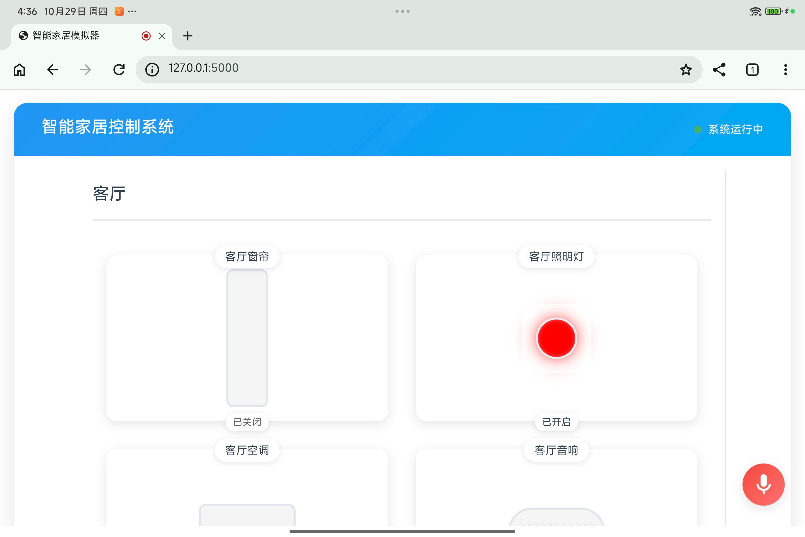
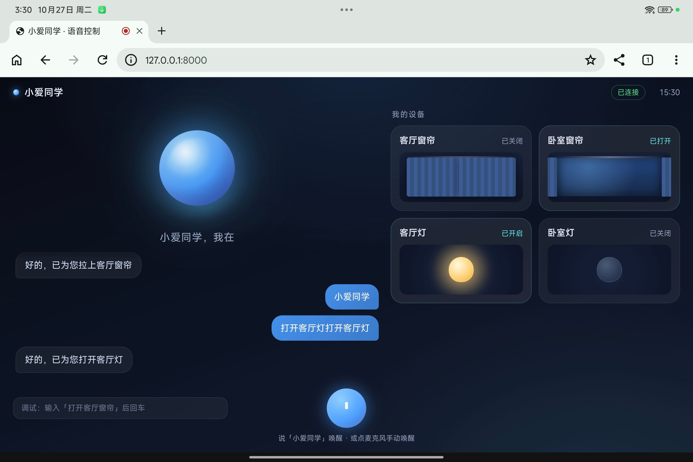

# 语音家居控制-261030
{: .no_toc }

`更新-261030` \| `发布-261027`

<details markdown="block">
  <summary>✳️ 目录</summary>
- TOC
{:toc}
</details>

---

## 简介

本次实验将使用 **语音实验箱** 实现通过语音控制家居。比如，用“打开客厅灯”的语音，就可以（模拟）打开客厅的灯。

### 教具

语音实验箱的终端是小米Pad7。已安装 ZeroTermux ，并且在 ZeroTermux 中安装了 Ubuntu 22.04。可以把小米Pad 7 当作 Linux 开发板使用。

### 任务

完成以下 3 个实验任务：

- 任务1：在小米Pad7 上完成通过语音控制家居的 App。
- 任务2：在小米Pad7 上体验 demo2。
- 任务3：在小米Pad7 上体验 demo3。

### 目标

通过本次实验，

- 了解和熟悉 ASR（Automatic Speech Recognition，自动语音识别）。
- 了解和熟悉 TTS（Text-to-Speech，文本转语音）。
- 了解 ZeroTermux 和 Ubuntu 相关操作。

### 账号密码

小米Pad7 的 ZeroTermux 的 Ubuntu 22.04 的账号密码：

- 账号：root
- 密码：xpad7

实验室 WiFi：

- 热点：b102_5G
- 密码：b102b102

### 建议目录

在 Pad 上新建实验目录：

```bash
mkdir -p ~/vesh1030
```

> 创建实验目录后，完整路径是 `/root/vesh1030`。

> `~` 表示用户的 HOME 目录。可使用 `echo $HOME` 查看。

> `vesh` 是 `Voice-Enabled Smart Home` 的缩写。

目录结构建议如下：

```bash
vesh1030/
├── app                        # 存放同学们开发的源码等文件
├── demo2                      # demo2 的相关源码的
│   ├── app.py
│   ├── static
│   │   ├── script.js
│   │   └── styles.css
│   └── templates
│       └── index.html
├── demo3                      # demo3 的相关源码等
│   ├── README.md
│   ├── backend
│   │   ├── app
│   │   ├── requirements.txt
│   │   ├── run.sh
│   │   └── runtime
│   ├── frontend
│   │   ├── app.js
│   │   ├── index.html
│   │   └── style.css
│   └── scripts
│       ├── deploy.sh
│       └── dev.sh
└── models                     # demo3 用到的本地模型。同学们可复用。
    ├── asr
    │   ├── model.int8.onnx
    │   ├── model.onnx
    │   └── tokens.txt
    ├── kws
    │   ├── README.md
    │   ├── ai_keywords.txt
    │   ├── configuration.json
    │   ├── decoder-epoch-12-avg-2-chunk-16-left-64.int8.onnx
    │   ├── ...
    │   ├── keywords.txt
    │   ├── keywords_raw.txt
    │   ├── test_wavs
    │   └── tokens.txt
    └── tts
```

说明：`demo2`、`demo3`、`models` 共 3 个子目录，由任务2、任务3中，执行 `scp` 命令，从实验室某个开发板上复制文件而生成。

[🔝](#top)

---

## 任务1-简介

任务1：在小米Pad7 上完成通过语音控制家居的 App。相关要求和建议如下：

- 用 Python 实现后端程序，部署在小米Pad7 的 ZeroTermux 的 Ubuntu 中。
- 用小米Pad7 上的浏览器打开访问，比如 `http://127.0.0.1:8000`。浏览器建议是 Chrome 浏览器，可通过小米Pad7 的**应用商店**安装。
- 对着小米Pa7 说“打开（关闭）客厅灯”，可以在 Web 界面上模拟打开（关闭）客厅灯。
- 至少控制 3 类（比如：灯，窗帘，空调，等）。
- 至少控制 9 种（比如：客厅灯，厨房灯，卧室灯，浴室灯；客厅窗帘，卧室窗帘；客厅空调，卧室空调，次卧空调；等）
- 建议有唤醒词。比如说“小爱小爱”（“小度小度”，……），唤醒语音控制 App，然后再说“打开客厅灯”。

以下是智能家居列表，供参考：
<details markdown="block">
  <summary>ℹ️ 智能家居列表</summary>

💡 照明系统：控制程度较细，覆盖开关、亮度、色温、颜色与模式。

- 开关：支持“打开/关闭XX灯”。
- 亮度：支持百分比调节（如“亮度调到百分之五十”），也支持相对调节（“调亮一点/暗一点”）。
- 色温/颜色：支持色温百分比调节，部分全色域灯支持指定颜色（如“调为蓝色”）。
- 模式切换：支持切换预设场景模式（如“影院模式”、“休闲模式”）。

🪟 智能窗帘：核心是开合控制，部分高端型号支持更精细的调节。

- 基础开合：支持语音“打开/关闭窗帘”。
- 开合比例：支持调整开合百分比（如“打开百分之五十”），部分型号支持自定义开合点。
- 进阶功能（部分型号）：如米家智能窗帘3 Pro支持左右独立分控（单轨左右窗帘分别控制）、10%~100%无极调速、缓起缓停。

❄️ 空调与温控：能力最丰富，几乎覆盖所有核心参数。

- 开关与模式：支持开关机，切换制冷、制热、除湿、送风、节能、辅热、干燥、睡眠等模式。
- 温度：支持设定具体温度（如“设为26度”）、相对调高/调低、调到最高/最低。
- 风速：支持调高/调低、设为最大/最小、指定档位（如三档）、设为自动风。
- 扫风与湿度：支持开启/停止上下扫风；部分型号支持设定目标湿度（如“湿度设为60%”）。
- 状态查询：支持查询当前温度、室内湿度。

🌀 风扇：控制程度中等，侧重风速与风感模式。

- 开关与风速：支持开关机、调节风速档位（如“调到二档”）。
- 风感模式：支持切换自然风、睡眠风、直吹风等模式。
- 摆头与定时：支持开关摆头（如120°左右摆头）、设置定时关机。

🔌 智能插座/开关：控制程度最基础，主要实现通断电。

- 核心能力：语音控制插座通断电，从而让非智能电器（如传统台灯、风扇）获得开关能力。
- 局限：无法调节传统电器的档位或参数，只能控制“有电/没电”。

📺 电视/机顶盒（红外遥控类）：依赖红外发射，功能以基础遥控为主。

- 核心能力：支持语音开关机、调音量、换台（需搭配万能遥控版音箱或红外伴侣）。
- 局限：无法深度控制电视内部菜单或应用，本质是模拟遥控器按键。

🧹 其他品类（扫地机/净化器等）

- 扫地机器人：通常支持语音指令启动清扫、暂停、回充。
- 空气净化器/加湿器：主流型号支持语音开关机；部分支持调节风速/档位，但具体指令需看设备是否开放对应接口。

</details>

以下是唤醒词列表，供参考：
<details markdown="block">
  <summary>ℹ️ 唤醒词列表</summary>

手机与系统助手

- 小米/Redmi：小爱同学 / 小爱小爱
- 华为/鸿蒙智行：小艺小艺 
- 苹果：嘿 Siri / Hey Siri 
- 荣耀：你好 YOYO / YOYO YOYO
- OPPO / 一加 / realme：小布小布 / 嘿 Breeno 
- vivo / iQOO：小V小V / Hi, Jovi
- 三星：Hi Bixby / 嗨，三星小贝 
- 魅族：Hey Aicy / 小溪小溪

新能源与智能车机

- 理想：理想同学 
- 蔚来：Hi NOMI / 嗨 NOMI 
- 小鹏：你好小P / 小P 
- 比亚迪：你好小迪 
- 问界：小艺小艺 
- 极氪：Hi EVA
- 零跑：小零 
- 埃安：你好北鼻
- 阿维塔：小塔小塔 
- 智己：你好智己 
- 极越：你好 Simo 
- 小米汽车：小爱同学 

传统车企与外资品牌

- 宝马：你好宝马 / Hey BMW 
- 奔驰：你好奔驰 
- 奥迪：你好奥迪
- 大众：你好大众
- 福特：你好福特 
- 吉利/领克：你好吉利 / Hi领克 
- 荣威：你好斑马 

智能音箱与地图

- 百度（小度/地图）：小度小度 
- 高德地图：小德小德 
- 天猫精灵：天猫精灵 / 你好天猫 
- 京东叮咚：叮咚叮咚 
- 腾讯听听：9420 

</details>

[🔝](#top)

---

## 任务1-分步骤实现建议

根据“任务1：在小米Pad7 上完成通过语音控制家居的 App”，可以分步骤实现，也可以整体实现。

建议在PC（个人电脑）上初步调测。基本完成后，部署到 Pad 上。

以下以分步骤实现，描述相关建议。

### 环境准备

在 Windows 下调测，建议也用 conda 创建虚拟环境。关于 Windows 下如何安装 conda，可参考：[Conda指南-Conda 安装（Windows）↗]。

启动**PowerShell终端**，执行以下命令创建虚拟环境：

```bash
conda create veshau python=3.11 pip -y
```

激活虚拟环境：

```bash
conda activate veshau
```

安装所需要的 Python 包：

```bash
pip3 install ...
```

### 文本控制

先搭建好前后端框架，用文本控制方式实现开关。

比如，在 Web 界面上有文本输入框，可以输入“打开（关闭）客厅灯”。Web 界面上有客厅灯的模拟（比如一个圆圈），根据输入可以打开（比如变黄）或者关闭（比如改成灰色）。

后端程序可以多输出一些调试信息，以免加快调试进程。

### 语音控制

**1、本地模型实现 ASR**

建议使用 sherpa-onnx 本地模型，实现 ASR。

本地模型可从 `172.18.145.189` 复制。复制命令如下：

```bash
scp -r jetson@172.18.145.189:/home/jetson/vesh1030/models .
```

> 上述命令最后的 .，表示复制到（PC 个人电脑的）当前目录。

本地模型包括如下：

```bash
vesh1030/
└── [4.0K]  models
    └── [4.0K]  asr
        ├── [ 78M]  model.int8.onnx
        └── [ 74K]  tokens.txt
```

在虚拟环境中安装 sherpa-onnx（⚠️安装前确保虚拟环境已激活）

```bash
pip3 install sherpa-onnx --prefer-binary
```

**2、RMS 和 VAD**

VAD（Voice Activity Detection，语音活动检测）。它的任务是判断“当前这段音频里有没有人在说话”。传统 VAD 会分析语音的声学特征（能量、过零率、频谱等），区分人声和背景噪声。你之前用的 silero_vad.onnx 是一个基于神经网络的 VAD 模型，判断更鲁棒，能适应不同噪声环境，但需要额外加载一个模型文件。

RMS（Root Mean Square，均方根）。它是音频信号振幅的统计量，计算方式是先对采样值平方、求平均，再开根号。直观理解就是“这段音频有多响”。

可以使用 VAD 或 RMS。

<details markdown="block">
  <summary>ℹ️ RMS相关片段</summary>

1、配置常量

```python
SAMPLE_RATE = 16000
FRAME_MS = 20
FRAME_SAMPLES = SAMPLE_RATE * FRAME_MS // 1000  # 每帧 320 个采样点

VAD_THRESHOLD = 0.012        # RMS 能量阈值，需按麦克风实测调整
VAD_SILENCE_MS = 500         # 静音多久认为一句话结束
VAD_MIN_SPEECH_MS = 200      # 最短语音时长，过滤瞬时噪声
VAD_MAX_UTTERANCE_MS = 5000  # 最长一句话，超时强制结束
```

2、RMS 端点检测类

```python
import numpy as np


class RMSVadSegmenter:
    """基于 RMS 能量的简易端点检测，替代 silero_vad。"""

    def __init__(self):
        self._voice_started = False   # 是否已检测到语音起点
        self._silence_ms = 0.0        # 当前连续静音时长
        self._speech_ms = 0.0         # 当前这句话的语音时长
        self._frames = []             # 当前这句话累积的音频帧
        self._pre_roll = []           # 触发前的少量帧，避免吞掉字头
        self._pre_roll_max = 5        # 保留 5 帧 ≈ 100ms

    def reset(self):
        self._voice_started = False
        self._silence_ms = 0.0
        self._speech_ms = 0.0
        self._frames = []
        self._pre_roll = []

    def feed(self, samples: np.ndarray):
        """
        输入一帧 float32 音频（长度 FRAME_SAMPLES），
        返回 (是否结束, 整段音频或 None)。
        """
        # 计算这一帧的 RMS 能量
        rms = float(np.sqrt(float(np.mean(np.square(samples))) + 1e-12))
        is_voice = rms >= VAD_THRESHOLD

        if is_voice:
            if not self._voice_started:
                self._voice_started = True
                # 把预滚帧拼进来，避免字头被切
                self._frames = list(self._pre_roll)
                self._pre_roll = []
            self._silence_ms = 0.0
            self._speech_ms += FRAME_MS
            self._frames.append(samples.copy())
        else:
            if self._voice_started:
                self._silence_ms += FRAME_MS
                self._frames.append(samples.copy())
            else:
                # 未触发时维护预滚缓冲
                self._pre_roll.append(samples.copy())
                if len(self._pre_roll) > self._pre_roll_max:
                    self._pre_roll.pop(0)

        # 结束条件：已有语音，且静音够久
        if self._voice_started and self._silence_ms >= VAD_SILENCE_MS:
            if self._speech_ms >= VAD_MIN_SPEECH_MS:
                audio = np.concatenate(self._frames) if self._frames else None
                self.reset()
                return True, audio
            else:
                # 太短，当作噪声丢弃
                self.reset()
                return False, None

        # 结束条件：超长强制结束
        if self._voice_started and self._speech_ms >= VAD_MAX_UTTERANCE_MS:
            audio = np.concatenate(self._frames) if self._frames else None
            self.reset()
            return True, audio

        return False, None
```

3、在 voice_worker 里调用

```python
def voice_worker():
    segmenter = RMSVadSegmenter()

    def callback(indata, frames, time_info, status):
        # indata 是 int16，转成 float32 并归一化到 [-1, 1]
        audio_queue.put(indata[:, 0].astype(np.float32) / 32768.0)

    with sd.InputStream(
        samplerate=SAMPLE_RATE,
        blocksize=FRAME_SAMPLES,
        dtype="int16",
        channels=1,
        callback=callback,
    ):
        buffer = np.array([], dtype=np.float32)
        while voice_running:
            chunk = audio_queue.get()
            buffer = np.concatenate([buffer, chunk])

            # 按 20ms 一帧切分，逐帧喂给 segmenter
            while len(buffer) >= FRAME_SAMPLES:
                frame = buffer[:FRAME_SAMPLES]
                buffer = buffer[FRAME_SAMPLES:]

                ended, audio = segmenter.feed(frame)
                if ended and audio is not None and len(audio) > 0:
                    # 这里把整段 audio 送给 Paraformer 识别
                    stream = recognizer.create_stream()
                    stream.accept_waveform(SAMPLE_RATE, audio)
                    recognizer.decode_stream(stream)
                    text = stream.result.text.strip()
                    if text:
                        recognized_queue.put(text)
```

</details>

### 语音播报

有很多方式可以实现，建议使用微软的 edge-tts（比较自然）。

需要在虚拟环境中安装相关包：（⚠️安装前确保虚拟环境已激活）

```bash
pip3 install edge-tts
```

### 优化 Web 界面

可以对 Web 界面的布局、格调，做适当优化。此处从略。

[🔝](#top)

### 部署到 Pad

可以在PC（个人电脑），通过 ssh 方式登录到 Pad 上操作。

**1、PC（个人电脑）先连 WiFi `b102_5G`**

**2、ssh 登录 Pada（PC）**

用 MoberXterm 软件，可 ssh 登录 Pad。

或者在 PC（个人电脑）的 PowerShell终端执行：（假定 Pad 的 IP 地址是 `192.168.31.211`）

```bash
ssh -p 2222 root@192.168.31.211
```

> (1) Pad 的 IP 地址：Pad 设置 → WLAN → b102_5G 行末的 `>` → IP地址<br>
> (2) root 的默认密码是 `xpad7`

**3、Pad 启动 sshd（Pad）**

如果无法 ssh 登录，

- 在 Pad 上运行 ZeroTermux
- 在 ZeroTermux 界面中执行：`proot-distro login ubuntu` （进入 Ubuntu）
- 在 Ubuntu 中执行：`/usr/sbin/sshd` （在 Ubuntu 中启动 sshd，就可以 ssh 登录了）

**4、创建实验目录（Pad）**

```bash
mkdir -p ~/vesh1030
```

**5、复制代码到 Pad（PC）**

在 PC 上执行：（假定代码等存放在当前目录的 app 子目录中）

```bash
scp -P 2222 -r app root@192.168.31.211:~/vesh1030 
```

**6、创建虚拟环境，并安装相关包（Pad）**

创建虚拟环境

```bash
conda create veshau python=3.11 pip -y
```

激活虚拟环境：

```bash
conda activate veshau
```

安装所需要的 Python 包：

```bash
pip3 install ...
```

**7、启动后台（Pad）**

略

**8、浏览器访问（Pad）**

略

[🔝](#top)

---

<!--  -->
## 任务2-体验demo2

**1、拷贝demo到Pad**

```bash
scp -r jetson@172.18.145.189:~/vesh1030/demo2 ~/vesh1030
```

**2、安装所需系统库**

```bash
apt update
apt install ffmpeg libportaudio2
```

> 代码里用了 pydub（需要 ffmpeg 处理音频）和 sounddevice（需要 portaudio 访问麦克风）。在 pip 安装之前，必须先在 Ubuntu 里装系统库。

**3、创建虚拟环境** （⚠️如已创建，则跳过此步骤）

```bash
conda create -n veshau python=3.11 pip setuptools wheel -y
```

**4、激活虚拟环境**（⚠️如已激活，则跳过此步骤）

```bash
conda activate veshau
```

**5、安装所需 Python 软件包到虚拟环境**

```bash
pip3 install flask requests sounddevice numpy scipy pydub
```

**6、启动demo后台**

```bash
cd ~/vesh1030/demo2
python3 app.py
```

**7、Pad浏览器访问**

Pad启动浏览器，访问 `127.0.0.1:5000`，可看到如下界面：



说明：

- 第一次点右下角圆圈，会询问是否网站允许访问麦克风，点击允许。
- 点一下圆圈，然后说话（比如，“打开客厅照明灯”）。说完后，再点一次圆圈，表示说完了）。
- 客厅窗帘，可跳过。其他，都可以体验。

[🔝](#top)

---

<!--  -->
## 任务3-体验demo3

**1、拷贝demo到Pad**

```bash
scp -r jetson@172.18.145.189:~/vesh1030/demo3 ~/vesh1030
scp -r jetson@172.18.145.189:~/vesh1030/models ~/vesh1030
```

**2、创建虚拟环境** （⚠️如已创建，则跳过此步骤）

```bash
conda create -n veshau python=3.11 pip setuptools wheel -y
```

**3、激活虚拟环境**（⚠️如已激活，则跳过此步骤）

```bash
conda activate veshau
```

**4、安装所需 Python 软件包到虚拟环境**

```bash
pip install -r ~/vesh1030/demo3/backend/requirements.txt
pip install edge-tts

```

**5、启动demo后台**

```bash
bash ~/vesh1030/demo3/backend/run.sh
```

**6、Pad浏览器访问**

Pad启动浏览器，访问 `127.0.0.1:8000`，可看到如下界面：



说明：

- 先说“小爱同学”，唤醒demo；然后说话（比如，“打开客厅灯”）。
- 再说“小爱同学”，唤醒demo；然后说话（比如，“打开客厅窗帘”）。

[🔝](#top)

---

## 收尾

### 关机

横放 Pad 时，长按**左侧上方**的电源开关。然后在屏幕**向上滑动**关机。

### 椅子复位

每桌 6 个椅子，推到桌下。

### 检查并带走随身物品

---

<span style="font-size:12px; color:#999">THE END</span>

<!-- [VSCode指南-远程连接↗]: https://tnt.gdvzz.com/aikit/vscodeug.html#remote-ssh
[Linux指南-vim文本编辑↗]: https://tnt.gdvzz.com/aikit/linuxug.html#vim
[VSCode指南-Jetson安装↗]: https://tnt.gdvzz.com/aikit/vscodeug.html#jetson
[Linux指南-scp远程复制文件/目录↗]: https://tnt.gdvzz.com/aikit/linuxug.html#scp
[MobaXterm指南-传文件↗]: https://tnt.gdvzz.com/aikit/mobaxtermug.html#sftp
[MobaXterm指南-ssh登录↗]: https://tnt.gdvzz.com/aikit/mobaxtermug.html#ssh
[Conda指南↗]: https://tnt.gdvzz.com/aikit/condaug.html -->

[Conda指南-Conda 安装（Windows）↗]: https://tnt.gdvzz.com/aikit/condaug.html#conda-win