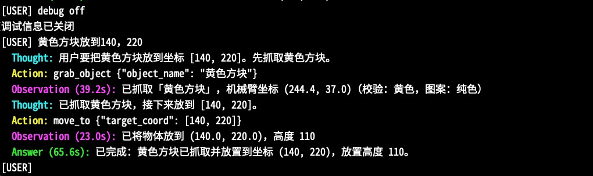
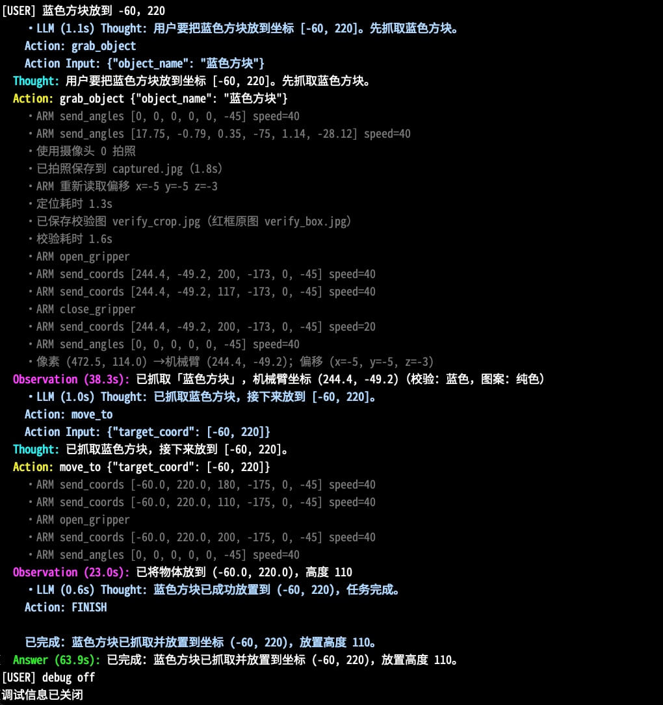
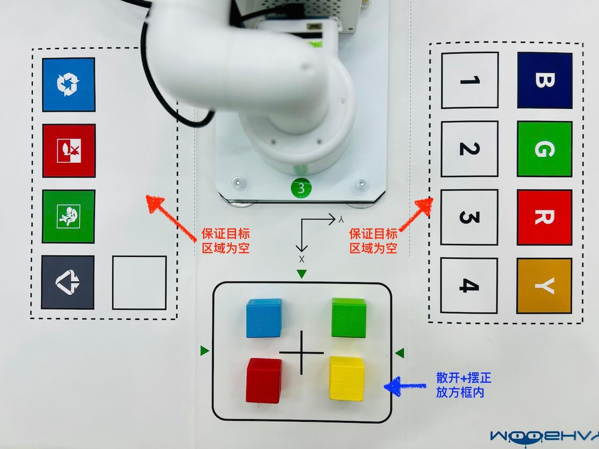

# 机械臂Agent开发-261127
{: .no_toc }

`更新-261127` \| `发布-261120`

<details markdown="block">
  <summary>✳️ 目录</summary>
- TOC
{:toc}
</details>

---

## 实验简介
<br>
参考视觉实验箱的机械臂现有样例程序，开发机械臂 Agent（智能体），控制机械臂做相关动作，是 ReAct/Agent 模式在具身智能里的一个实例。通过本次试验，希望达成以下目标：

- 进一步了解 Agent（智能体）的原理；
- 进一步熟悉 Agent（智能体）开发的相关操作；
- 初步了解 Agent（智能体）开发的工程相关要求。

在整个系统中：

- LLM：负责“下一步干什么”的决策/规划
- VLM：负责“看”，是感知工具
- 工具调用：负责“动”，比如 move_to、grasp、release、home
- 机械臂/相机/夹爪：执行动作并返回 Observation


| ReAct 概念 | 对应机械臂Agent里 |
|---|---|
| Thought | LLM 内部推理或结构化 plan：先找红色积木，再对准，再抓 |
| Action | 调用工具：`detect_object("red_block")`、`move_to(x,y,z)`、`grasp()` |
| Observation | VLM 返回 bbox/3D 坐标、夹爪状态、运动执行结果、相机图像 |
| Final Answer | 任务完成，比如“已抓住红色积木” |

<br>
LLM 是大脑，VLM 是眼睛，机械臂工具是手，Agent 程序本身是“神经和调度员”。Agent 程序本身主要完成：

1. 接收任务：用户说“抓红色积木”
2. 组织上下文：把任务、历史动作、当前状态整理给 LLM
3. 问 LLM：下一步干嘛？
4. 解析 LLM 输出：它说要调 detect_red_block
5. 真正去调用 VLM 工具
6. 拿到 VLM 返回的坐标
7. 把结果再喂给 LLM：眼睛说积木在这里
8. LLM 说 move_to / grasp
9. 程序去调用机械臂接口
10. 把机械臂执行结果再喂回去
11. 循环，直到 LLM 说完成，或程序判断成功/失败/超步数

> 上述只是描述大致原理。其中工具的名称，不是相应工具的真实名称。

> LLM 全称：Large Language Model（大语言模型），VLM 全称：Vision-Language Model（视觉语言模型）。以下统称 LLM 或 大模型。

### 任务
<br>
要完成以下实验任务：

1. 实验完成的 Agent，能清晰输出“Thought - Action - Observation”的流程的信息。
2. 输出机械臂 Agent 原理，尽可能详细。
3. 在 Agent（智能体）开发调测过程中，遇到哪些问题？什么原因导致了这些问题？是否要优先解决？怎么解决的（如果要优先解决）？建议至少描述 3 个问题。

### 主要硬件
<br>
本次试验用到以下主要硬件：

- **主机**：NVIDIA Jetson Orin NX 16GB（Ubuntu / JetPack 5.1.3）
- **屏幕**：HDMI 接口屏幕
- **外设**：USB 鼠标键盘
- **机械臂**：可抓取积木的教学用机械臂

[🔝](#top)

---

## 相关信息

### 操作规范
<br>
请参考以下建议：

- 🚫 水杯、饮料瓶**不得放桌上**（放地上或包里）
- 🚫 电源线、网线**从桌子中间空洞穿**，不绕四周
- 🚫 书包等**远离开发板**（放地上）
- 🚫 不要挪动机械臂的位置（如需要，请联系实验室老师）
- ✅ 关机后再断电

### 账号信息
<br>
开发板账号信息如下：

- 账号：jetson
- 密码：yahboom

实验室 WiFi：（如果需要用到）

- 热点：b102_0712_5G
- 密码：b102b102gb5

### 快捷操作
<br>
有以下主要快捷操作：

- 按 `tab` 键可补齐文字，加快输入。假定当前目录下有 3 个子目录（face_mesh，gesture_recognizer，haar_detection），输入 `cd ges` 后按 `tab`键，则补齐为 `cd gesture_recognizer/`。
- 按 `↑↓箭头` 键，可以找到输入过的命令。不必每次都重复敲命令。
- 终端App中：（复制） `Ctrl` + `Shift` + `C`；（粘贴）`Ctrl` + `Shift` + `V`

### ssh登录
<br>
可以在开发板上直接操作。

或者用PC（个人电脑） ssh 登录开发板操作。在 PC（个人电脑）打开 **PowerShell终端**，执行以下命令：（假设开发板的 IP 地址是 172.18.145.13）

```bash
ssh jetson@172.18.145.13
```

还可以用 MobaXterm 软件 ssh 登录开发板，详见：[MobaXterm指南-ssh登录↗]。

> 获取开发板的 IP 地址。在开发板上启动 **Terminal终端**，执行 `ifconfig | grep 172` （命令显示网络相关信息中含有 172 的那些行的信息，因为实验室网络 IP 地址是 172.18.145.xx）

> 如果 ssh 登录开发板进行操作，则可以把开发板的屏幕合起来在保护套中，显示屏朝下放平在实验桌上，鼠标和键盘放在屏幕的保护套上，以腾出空间。

[🔝](#top)

---

## 开机
<br>
找到桌子下方（在机械臂所在位置的下方）带开关的插座，按下开关接通电源。稍等片刻，机械臂自启完成站立，屏幕显示桌面，则表示启动完成。

[🔝](#top)

---

## 验证现有demo
<br>
**1、创建实验目录**

在开发板上创建实验目录，比如：

```bash
mkdir -p ~/a2lab/raa1127
```

> `~` 表示 jetson 用户的 HOME 目录，默认是 `/home/jetson`，因此完整的路径是： `/home/jetson/a2lab/raa1127`。

<br>
**2、下载现有demo**

下载链接：[viki1113.zip](./viki261113.assets/viki1113.zip)

在开发板上用浏览器下载，通常保存在目录 `~/Downloads` 中。`~` 表示 jetson 用户的 HOME 目录，默认是 `/home/jetson`，因此完整的路径是： `/home/jetson/Downloads`。

并移动到 `~/a2lab/raa1127`：

```bash
mv ~/Downloads/viki1113.zip ~/a2lab/raa1127
```

如果在PC（个人电脑）上用浏览器下载，也是保存在默认目录 `~/Downloads` 中，则可以执行以下命令，将 zip 包复制到开发板的实验目录中：

```bash
scp ~/Downloads/viki1113.zip jetson@172.18.145.13:~/a2lab/raa1127
```

<br>

在开发板上解压缩：

```bash
cd ~/a2lab/raa1127
unzip viki1113.zip
```

> 解压缩后，会生成子目录 `~/a2lab/raa1127/viki1113`，现有 demo 在该子目录中。

<br>
**3、运行现有demo**

切换到现有 demo 所在目录：

```bash
cd ~/a2lab/raa1127/viki1113
```

激活 demo 运行所需虚拟环境：

```bash
conda activate viki
```

如果虚拟环境 viki 不存在，可以创建一个新的虚拟环境 raabr：

```bash
conda create -n raabr python=3.10 pip setuptools wheel -y
conda activate raabr
pip3 install openai requests numpy opencv-python==4.10.0.84 pymycobot==3.4.9 pyaudio soundfile pillow Jetson.GPIO scipy
```

运行 demo：

```bash
python3 agent.py
```

在机械臂前方，放置几个颜色积木，并尝试抓取移动蓝色方块。在 `<USER>:` 提示符后输入 `grab blue cube and move to 0,200`

```text
python3 agent.py
WARNING: Carrier board is not from a Jetson Developer Kit.
WARNNIG: Jetson.GPIO library has not been verified with this carrier board,
WARNING: and in fact is unlikely to work correctly.
<USER>:grab blue cube and move to 0,200
```

[🔝](#top)

---

## 实验建议

### 整体建议
<br>
**1、实验目录**

建议在开发板上新建实验目录，相关文件都放在该目录下。可通过以下命令新建实验目录：

```bash
mkdir -p ~/a2lab/raa1127
```

> 在当前用户（jetson）的 HOME 目录下新建实验目录。完整的路径一般是：`/home/jetson/a2lab/raa1127`。

<br>
**2、创建虚拟环境**

在开发板上新建虚拟环境，运行自己的Agent程序。在虚拟环境中运行项目，可和开发板上的其他项目互不影响。

```bash
conda create -n raabr python=3.10 pip setuptools wheel -y
conda activate raabr
pip3 install xxx
```

> 新建虚拟环境 `raabr`，Python 选用 3.10 版本（根据自己的Agent代码，按需调整 Python 的版本）。创建虚拟环境时，安装必要的包（如pip，setuptools，wheel等）。

> 用 pip3 安装相关包（自己的Agent程序所需的），到虚拟环境中。⚠️ 安装前，一定要先激活已创建的虚拟环境（否则就安装到其他环境中了）

> 虚拟环境创建一次即可。不必每次重复创建。

### AI编程工具
<br>
可以手写代码，或者使用 AI 编程工具辅助完成实验代码。⚠️ 使用 AI 编程工具时，可要求多加代码注释。要求知晓原理，并读懂代码。

可使用自己习惯的 AI 编程工具。如尚未使用 AI 编程工具，可尝试使用 OpenCode。OpenCode 简介如下：

- 访问 opencode.ai 下载安装。可以优先使用 Desktop 版。
- 🌟 有若干内置的免费模型，可供使用。直接用免费的模型，可马上开始工作。
- 有免费的额度。不是重度使用，一般不会用完。假定用完免费额度，一般第二天可复活。

<br>

- 点击左上角**主页**（3个方块 1个+） → **Setting（设置）** → **Prefernces（偏好设置）**  → **Language（语言）**，可选“中文/英文”。
- 点击左上角**主页**（3个方块 1个+） → **Setting（设置）** → **Prefernces（偏好设置）**  → **Show Agent（显示智能体）**，打开。回到输入框界面，就可以看到 Build / Plan 模式切换了。
- 点击左上角**主页**（3个方块 1个+） → **Setting（设置）** → **Appearance（外观）**  → **Color scheme（配色方案）**，可选“系统/浅色/深色”。

<br>

- 点击左上角**主页**（3个方块 1个+） → **Projects（项目）** → 右边“添加项目”的图标，可以添加一个新项目。项目A是语音控制机械臂，项目B是语音控制家居，……
- 同一个项目中，还可以新建会话。比如有个新想法要试试，但不想污染原来的会话。

### 生成 Agent
<br>
以 AI 辅助编程为例。

**1、先理解原有样例程序**

在PC（个人电脑）或开发板上，创建实验目录。让 AI 辅助编程工具在该目录中工具。

```bash
mkdir -p ~/a2lab/raa1127
```

将原有样例程序放到比如 `~/a2lab/raa1127/viki1113`，告知 AI 辅助编程工具先理解和读懂代码。

<br>
**2、构建 Agent**

在此基础上，提出相关要求和设想，让 AI 编程工具构建新版 Agent。比如：

```md
- 构建新版 agent。所有新程序，放在当前目录 raa1127 下的 app 子目录。新程序不要去引用旧程序，复制一份必须复用的旧带代码到 app 目录中。
- 新版 agent 尽可能简洁。去除不必要的代码；调试/模拟代码都单独成文件，不要和正式代码混在一个文件中。
- 新版 agent 尽可能扁平。去除不必要的子目录。
- 虚拟环境使用 conda 创建。假设 conda 已安装了。
- 输出信息要能体现 ReAct/Agent 的流程，比如：Thought - Action - Observation

<!--  -->
- LLM、VLM等，复用老代码中的信息。
- 机械臂标定（仿射矩阵）等，也复用老代码中的信息。
- 机械臂运动方式，也服用老代码的方式。比如，先移动到某个位置后拍照，然后抓取；抓到后再回到原位，再移动到目标位置，等。
……
```

⚠️ 关于机械臂运动方式。由于目前对机械臂本身了解不多，建议此次实验复用原有样例代码中的方式，以免导致运动不大正常。

<br>
在完成 Agent 基本能力构建后，可尝试优化工程相关特性。比如：

```md
- 解决“打不开摄像头”的问题。
- 解决“找不到机械臂”的问题。
- 使用debug 开关，输出更多详细信息，用于调试。比如，每个步骤用了多少时间，详细步骤是哪些，等。
- 可以用上下箭头翻看命令的历史，减少重复输入命令的次数。
- 支持多轮对话。比如，先输命令“抓蓝色方块”，再说命令“放到0，200”。
- 中文英文都支持。
……
```

<br>
**3、调试修复bug**

略

### 输出样例
<br>
以下是输出样例，供参考。

<details markdown="block">
  <summary>黄色方块放到140，220</summary>

```text
[USER] debug off
调试信息已关闭
[USER] 黄色方块放到140，220
  Thought: 用户要把黄色方块放到坐标 [140, 220]。先抓取黄色方块。
  Action: grab_object {"object_name": "黄色方块"}
  Observation (39.2s): 已抓取「黄色方块」，机械臂坐标 (244.4, 37.0)（校验：黄色，图案：纯色）
  Thought: 已抓取黄色方块，接下来放到 [140, 220]。
  Action: move_to {"target_coord": [140, 220]}
  Observation (23.0s): 已将物体放到 (140.0, 220.0)，高度 110
  Answer (65.6s): 已完成：黄色方块已抓取并放置到坐标 (140, 220)，放置高度 110。
[USER]
```


</details>

<details markdown="block">
  <summary>蓝色方块放到 -60，220</summary>

```text
[USER] 蓝色方块放到 -60，220
    · LLM (1.1s) Thought: 用户要把蓝色方块放到坐标 [-60, 220]。先抓取蓝色方块。
    Action: grab_object
    Action Input: {"object_name": "蓝色方块"}
  Thought: 用户要把蓝色方块放到坐标 [-60, 220]。先抓取蓝色方块。
  Action: grab_object {"object_name": "蓝色方块"}
    · ARM send_angles [0, 0, 0, 0, 0, -45] speed=40
    · ARM send_angles [17.75, -0.79, 0.35, -75, 1.14, -28.12] speed=40
    · 使用摄像头 0 拍照
    · 已拍照保存到 captured.jpg（1.8s）
    · ARM 重新读取偏移 x=-5 y=-5 z=-3
    · 定位耗时 1.3s
    · 已保存校验图 verify_crop.jpg（红框原图 verify_box.jpg）
    · 校验耗时 1.6s
    · ARM open_gripper
    · ARM send_coords [244.4, -49.2, 200, -173, 0, -45] speed=40
    · ARM send_coords [244.4, -49.2, 117, -173, 0, -45] speed=40
    · ARM close_gripper
    · ARM send_coords [244.4, -49.2, 200, -173, 0, -45] speed=20
    · ARM send_angles [0, 0, 0, 0, 0, -45] speed=40
    · 像素 (472.5, 114.0) → 机械臂 (244.4, -49.2)；偏移 (x=-5, y=-5, z=-3)
  Observation (38.3s): 已抓取「蓝色方块」，机械臂坐标 (244.4, -49.2)（校验：蓝色，图案：纯色）
    · LLM (1.0s) Thought: 已抓取蓝色方块，接下来放到 [-60, 220]。
    Action: move_to
    Action Input: {"target_coord": [-60, 220]}
  Thought: 已抓取蓝色方块，接下来放到 [-60, 220]。
  Action: move_to {"target_coord": [-60, 220]}
    · ARM send_coords [-60.0, 220.0, 180, -175, 0, -45] speed=40
    · ARM send_coords [-60.0, 220.0, 110, -175, 0, -45] speed=40
    · ARM open_gripper
    · ARM send_coords [-60.0, 220.0, 200, -175, 0, -45] speed=40
    · ARM send_angles [0, 0, 0, 0, 0, -45] speed=40
  Observation (23.0s): 已将物体放到 (-60.0, 220.0)，高度 110
    · LLM (0.6s) Thought: 蓝色方块已成功放置到 (-60, 220)，任务完成。
    Action: FINISH
    
    已完成：蓝色方块已抓取并放置到坐标 (-60, 220)，放置高度 110。
  Answer (63.9s): 已完成：蓝色方块已抓取并放置到坐标 (-60, 220)，放置高度 110。
[USER] debug off
调试信息已关闭
```

</details>


### 机械臂简要说明
<br>
**1、放置积木，并确保目标区域为空**

[](./viki261127.assets/s4-map.jpg)

> 不需要图纸，也能完成抓取。如需要图纸，可联系实验室老师。

> 如铺放了图纸，请将机械臂底座和图纸上的方框对齐（如上图所示）。

**2、移动积木到目标坐标**

建议的目标坐标如下：

- 蓝色积木：`-60,220,110`
- 绿色积木：`10,220,110`
- 红色积木：`80,220,110`
- 黄色积木：`140,220,110`

> 按此颜色积木对应的目标坐标，可尽可能确保目标坐标是空的可用的。

<br>
✳️ **坐标位置说明：**

- x 和 y 的原点，在机械臂圆柱形底座的中心，大致位于桌面上
- 桌面的 z 的坐标，大致是 110
- xy 的方向：箭头方向，是正方向。（（在机械臂和实线框之间，画有带箭头的 xy 方向）
- z 的方向：桌面朝上的方向，是正方向。
- 上述坐标的单位：mm（毫米）
- 因此（x,y）：（-60,220）≈ 蓝色 B 字母，（-10,220）≈ 绿色 G 字母，（80,220）≈ 红色 R 字母，（140,220）≈ 黄色 Y 字母

<br>
✳️ **调整偏移：**

教学用机械臂，相比工业用机械臂，精度要低一些，因此有时抓得不是很准。可通过修改 `config.json`（如下所示） 的 x y z 的偏移值，让机械臂抓得准确些。

可用软件 VSCode 修改，或求助老师。

```yml
{
    "points_pixel": [
        [320,220],
        [590,430],
        [72,31],
        [590,26]
    ],
    "points_arm": [
        [210,0],
        [140, -80],
        [280,80],
        [280,-80]
    ],
    "x": -8,
    "y": -5,
    "z": -5,
    "voice":false,
    "threshold": 110
}
```

🚫 **请不要指挥机械臂将积木放到已有物体的目标坐标，有可能损坏机械臂**

[🔝](#top)

---

## 结束离开

### 先关机再断电
<br>
请参考如下步骤：

1. 点击屏幕右上角 **电源标志** → Power Off → Power Off<br>或者执行命令：`sudo poweroff` <br>或者执行命令：`sudo shutdown -h now` 
2. 等风扇停止（或者网线插口的灯灭了），表示已关机。⚠️ 一定要确保已关机。否则可能无法再次启动。
3. 找到桌子下方（在机械臂所在位置的下方）带开关的插座
4. 轻轻推倒机械臂，水平卧在机箱上

### 椅子复位
<br>
每桌 6 个椅子，推到桌下。

### 检查随身物品并带走

---

<span style="font-size:12px; color:#999">THE END</span>

[VSCode指南-远程连接↗]: https://tnt.gdvzz.com/aikit/vscodeug.html#remote-ssh
[Linux指南-vim文本编辑↗]: https://tnt.gdvzz.com/aikit/linuxug.html#vim
[VSCode指南-Jetson安装↗]: https://tnt.gdvzz.com/aikit/vscodeug.html#jetson
[Linux指南-scp远程复制文件/目录↗]: https://tnt.gdvzz.com/aikit/linuxug.html#scp
[MobaXterm指南-传文件↗]: https://tnt.gdvzz.com/aikit/mobaxtermug.html#sftp
[MobaXterm指南-ssh登录↗]: https://tnt.gdvzz.com/aikit/mobaxtermug.html#ssh
[Conda指南↗]: https://tnt.gdvzz.com/aikit/condaug.html